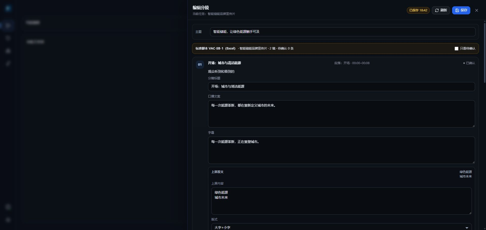
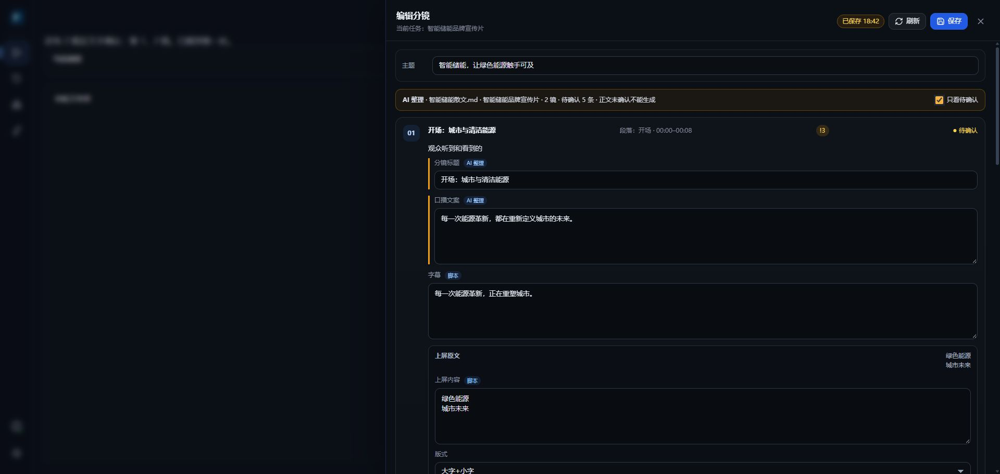
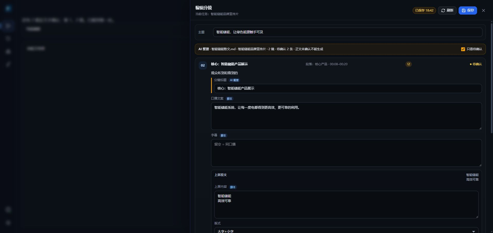
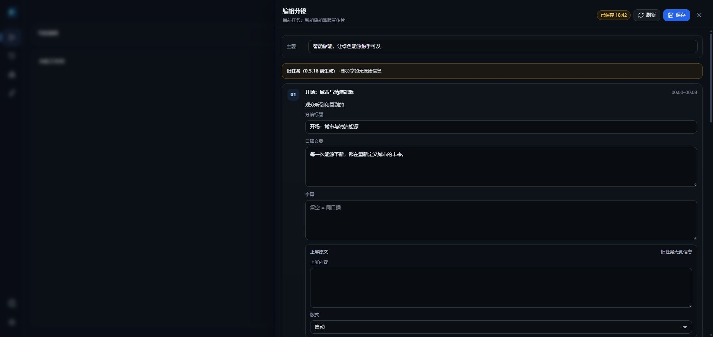
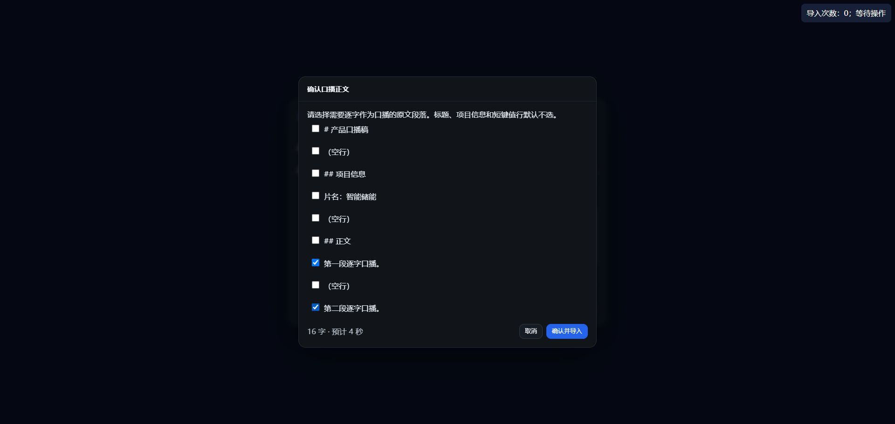
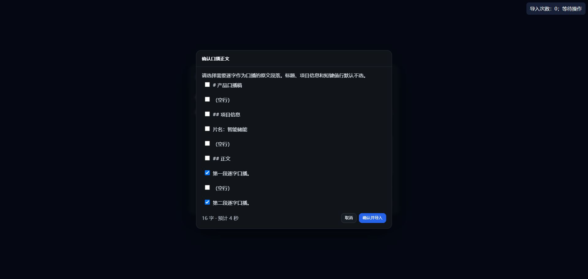
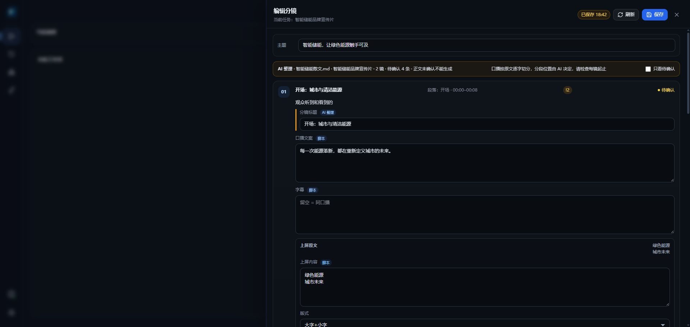
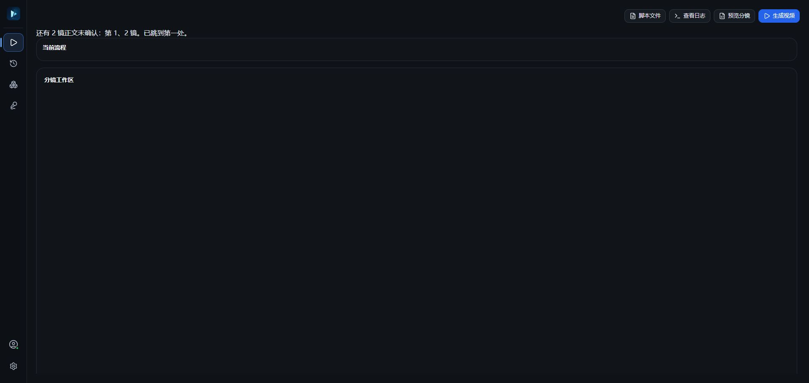
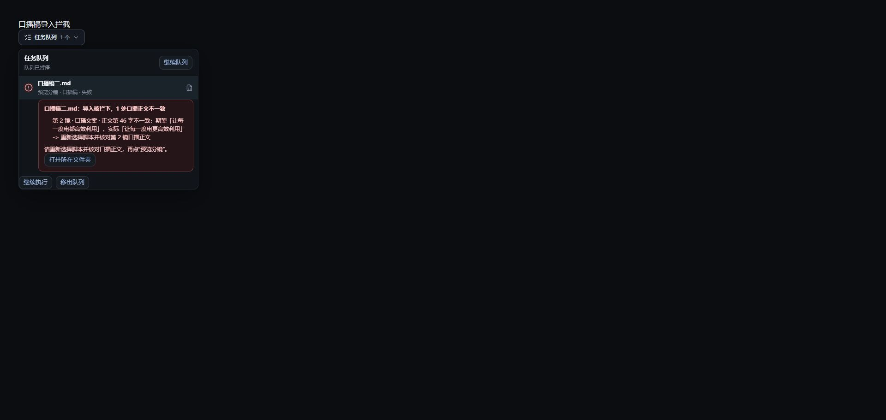
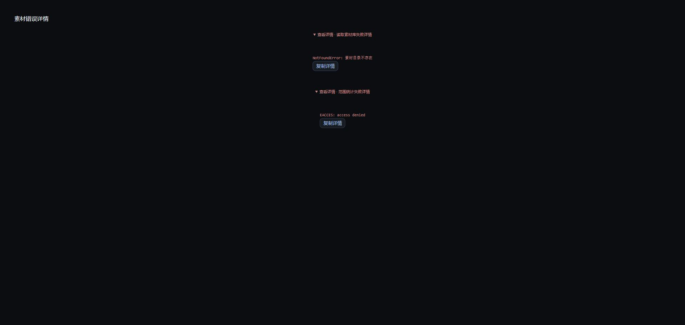

# 0.5.16 脚本输入步骤 4 验收证据

候选基线：`b544f4a8aaa89ef2edb677ae26a36e8dde0b81df`（detached worktree）。本步骤只改桌面端；未改 Python、Rust、生产配置与打包流程，也未调用真实模型、上传或出片。

## 自动验收

- Desktop focused：99/99 通过。
- Desktop 全量：437 项，435 通过、2 跳过、0 失败；跳过数未增加。
- `npm run build`：exit 0。
- `npm run lint`：与冻结基线完全相同，10 errors + 1 warning，没有新增诊断；两处本步文件仅行号移动。
- Python/Rust/N1–N3/N5 独立验收通过：Python 677 项（675 通过、2 跳过），Rust 119 通过、4 accepted ignored，N1 为 5 个 xlsx + 225 states，N3 模板与 legacy ASS 均与 a29 字节一致。
- N4 使用 a29 与候选的真实 open/save 产物互比通过。
- `git diff --check` 通过；`VideoAutoCut` 与 `VideoAutoCutApp` 无差异。

完整命令、stdout、exit 与独立收据保存在本地审计目录 `s516-step4-evidence-51485521`。最终有效日志前缀为 `final5-`，build 的最终成功重跑为 `final5b-build`。

## 冻结 lint 前后对照

基线来自 51485246 的工具输出转录（不是持久化的原始 stdout）；候选来自最终重定向保存的 `final5-lint.raw.log`。冻结身份按文件、规则和条数比较，行号允许因本步代码移动。

| 文件 | 规则 | 基线 error | 基线 warning | 候选 error | 候选 warning |
|---|---|---:|---:|---:|---:|
| `src/App.tsx` | `react-hooks/set-state-in-effect` | 1 | 0 | 1 | 0 |
| `src/motion-filter-preview.tsx` | `react-refresh/only-export-components` | 2 | 0 | 2 | 0 |
| `src/pages/materials/MaterialDeleteDialog.tsx` | `react-hooks/set-state-in-effect` | 1 | 0 | 1 | 0 |
| `src/pages/materials/MaterialMediaPlayer.tsx` | `react-hooks/set-state-in-effect` | 1 | 0 | 1 | 0 |
| `src/pages/materials/MaterialMoveDialog.tsx` | `react-hooks/set-state-in-effect` | 1 | 0 | 1 | 0 |
| `src/pages/materials/PublicMaterialDialog.tsx` | `react-hooks/set-state-in-effect` | 1 | 0 | 1 | 0 |
| `src/pages/materials/PublicMaterialDialog.tsx` | `react-hooks/exhaustive-deps` | 0 | 1 | 0 | 1 |
| `src/pages/materials/useMaterialsLibrary.ts` | `react-hooks/set-state-in-effect` | 1 | 0 | 1 | 0 |
| `src/pages/start/ScriptFilesDialog.tsx` | `react-hooks/set-state-in-effect` | 1 | 0 | 1 | 0 |
| `src/pages/start/ShotEditorDrawer.tsx` | `react-hooks/set-state-in-effect` | 1 | 0 | 1 | 0 |
| **合计** |  | **10** | **1** | **10** | **1** |

## Renderer UI 验收

以下截图来自受控 Chrome 中运行的真实 renderer 产品组件，文件、模型与 IPC 数据源使用固定 fixture。它们证明桌面 UI 和交互逻辑，不代表安装版 native E2E、真实模型或生产引擎联调；安装版总验收留在后续授权步骤。

### 三类来源与统一抽屉

标准 VAC-SB-1（Excel）显示完整字段且不显示来源标签：

AI 整理任务确认前后：来源标签、分组、待确认过滤与计数均由真实组件更新。

旧任务显示兼容提示、完整可编辑正文和禁用的缺失制作字段：

### 正文硬门禁与口播稿

正文未确认时显示总数、镜号并跳到第一处：

口播正文确认窗按原文段落默认选择，按 4.2 字/秒显示时长；第二份文件重新初始化为独立正文：

逐字口播导入结果中，`voice_text` 来源为脚本、字幕为空且口播不进入 AI 建议；标题仍受正文硬门禁。逐镜确认标题后，即使画面制作字段仍待确认，也可进入生成：

口播逐字校验失败复用真实任务队列组件，显示第 2 镜、正文第 46 字、期望/实际片段及重新选择并核对正文的动作：

### 素材错误详情

读取与范围统计两条失败通道分别显示可展开、可复制的原始 `name: message`：

## 过程偏差与修正

- 初次 renderer fixture 未在组件挂载前补齐事件订阅桥，出现 `window.videoAutoCut` 缺失；补齐固定 IPC bridge 后重测通过。
- Vite 开发期 HMR 曾因重复 `createRoot` 重置交互状态；受干扰操作已在稳定页面重测，错误/阶段性截图未计入通过证据。
- 早期 lint 出现超出冻结基线的新增诊断；迁移纯 helper 并稳定 callback 后，最终回到精确 10 errors + 1 warning。
- `final3` 的两个 D4 测试因生产 helper 改成 `useCallback` 后测试提取器未同步而失败；测试提取器改为执行真实 callback，`final4`/`final5` 全量稳定通过。
- `final5-build` 首次因仅用于截图的 blocked fixture 缺少 `ScriptImportReport` 展示字段而 TypeScript 失败；补齐 `route/format/file/shots` 后，`final5b-build` exit 0。

## 范围说明

本步骤仅把 `voiceScriptBodyPath` 在桌面队列、重启恢复和 task service CLI 参数中贯通。Rust 的参数解析/转发、S5/S6 与正式引擎编译按既定计划留到步骤 5 同一提交、只编一次。因此本步骤不宣称安装版 engine E2E。

本步测试 diff 仅新增断言，没有修改或放宽既有断言。里程碑早期经 Mac 明确批准的 N4 真实 open/save 深相等口径保持不变，并继续由现有测试覆盖。

开发与测试使用的 `node_modules` 是指向主仓 `VideoAutoCutDesktop/node_modules` 的 junction；本步没有执行 npm install、没有修改 package 清单，并且该 junction 严禁用于打包。
